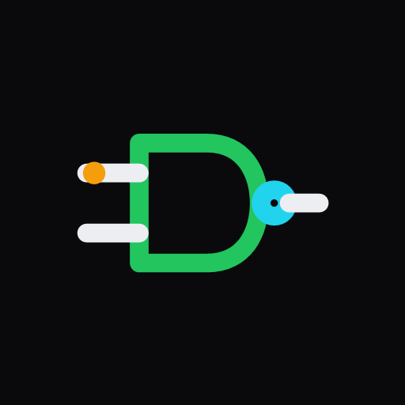
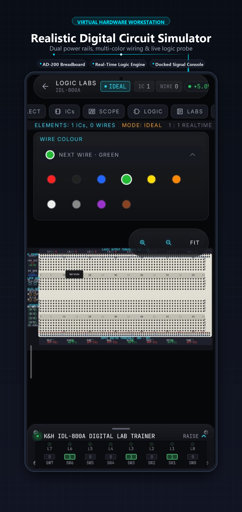
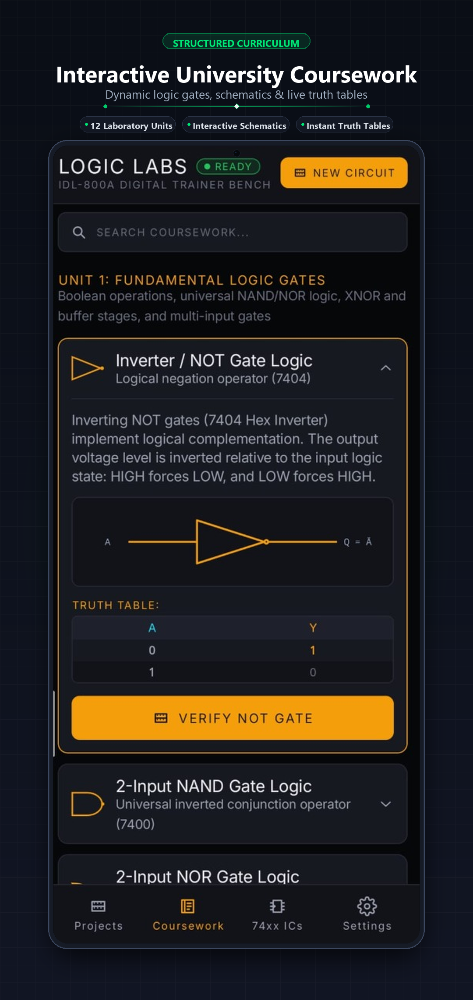
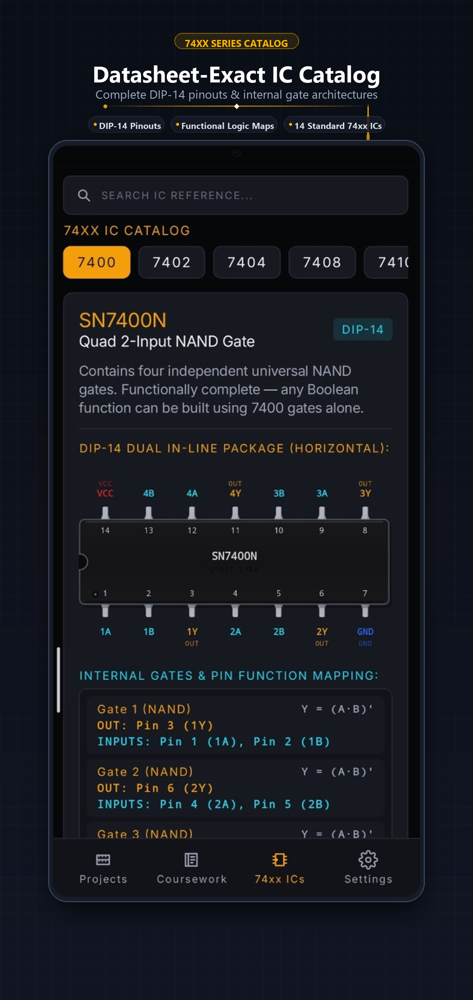
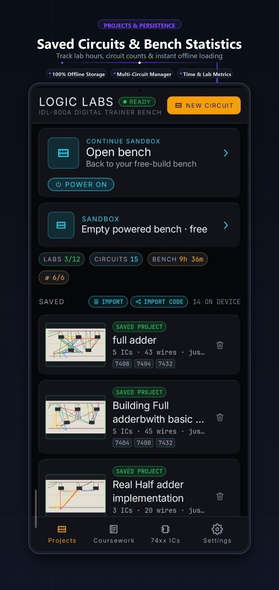
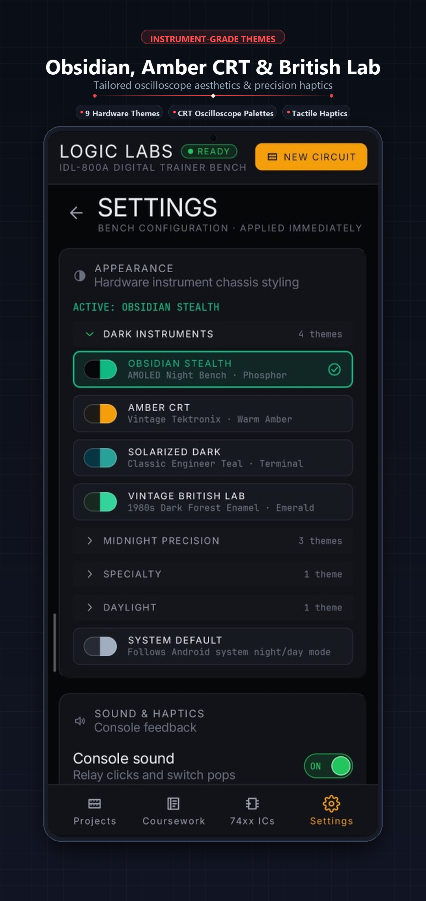

<div align="center">



# Logic Labs

### A digital electronics lab that fits in your pocket.

Build real 74xx chip circuits on a lifelike breadboard, test them with trainer-style tools, and check your work automatically.<br>
No internet. No account. No tracking.

[][fdroid]

[][fdroid]
[](https://github.com/AdnanFoisal/LogicLabs/releases)
[](https://developer.android.com)
[](LICENSE)
[](#privacy)

</div>

---

## Screenshots

<table>
  <tr>
    <td align="center"></td>
    <td align="center"></td>
    <td align="center"></td>
    <td align="center"></td>
    <td align="center"></td>
  </tr>
  <tr>
    <td align="center"><sub><b>Breadboard</b><br>Build and test circuits</sub></td>
    <td align="center"><sub><b>Coursework</b><br>Guided lab experiments</sub></td>
    <td align="center"><sub><b>Chip catalog</b><br>Pinouts and diagrams</sub></td>
    <td align="center"><sub><b>Projects</b><br>Saved circuits and stats</sub></td>
    <td align="center"><sub><b>Themes</b><br>Make the bench yours</sub></td>
  </tr>
</table>

---

## What is Logic Labs?

Logic Labs is a free, open-source Android app for learning and practising digital electronics. It recreates a real university lab bench on your device: the **K&H IDL-800A** digital trainer, with its **AD-200** solderless breadboard.

You place chips such as the 7400 (NAND) or 7408 (AND), connect them with wires, flip switches, and watch LEDs, displays and an oscilloscope react. When you are done, the app can test your circuit against every possible input and give you a printable PDF report.

Most circuit apps show flat diagrams. Logic Labs shows the real layout instead: real chip pinouts, real breadboard rows, real wiring. What you practise here carries over to the physical bench.

**Who is it for?**

- **Students** taking a digital logic or electronics course who want to practise away from the lab
- **Teachers and lab instructors** who want a hands-on tool students can use anywhere
- **Hobbyists and self-learners** curious how gates, adders, and counters really work

### How it works

1. **Build.** Place chips on the breadboard and connect them with jumper wires.
2. **Run.** Feed signals in with switches, pulse buttons, or a clock. Watch the LEDs, displays, and oscilloscope.
3. **Check.** Let the app test every input combination and tell you whether your circuit is correct.

---

## Download

| Source | How |
|---|---|
| **F-Droid** (recommended) | Open the F-Droid app and search for **Logic Labs**, or visit the [F-Droid package page][fdroid]. |
| **GitHub** | Get tag list, release notes, and source code from [Releases](https://github.com/AdnanFoisal/LogicLabs/releases) or [Tags](https://github.com/AdnanFoisal/LogicLabs/tags). |

Requires **Android 8.0 or newer**.

> **Tip:** Install from one source only. Apps from F-Droid and GitHub may be signed with different keys, so you may need to uninstall before switching between them.

---

## Features

### The breadboard

- **A full-size AD-200 layout:** 1,896 connection points, seven power rails, and the centre trench where chips sit.
- **Wires that look and move like the real thing.** They curve and sag, and come in ten colours: red, black, blue, green, yellow, white, orange, purple, gray, and brown.
- **Easy, precise wiring.** Drag a wire, or tap one point and then another. Wires snap to holes, and a 2.2x magnifier follows your finger so you can see exactly where you are connecting.
- **Two difficulty modes.** *Educational mode* is forgiving. *PRACTICAL mode* is not: reverse the power or short two outputs together and the chip burns out, with sound and a visual warning.

### The trainer console

- **8 data switches** (SW0 to SW7) with a realistic rocker feel
- **2 pulse buttons** that give a clean single pulse, with Q and Q-bar (opposite) outputs
- **8 LEDs** (L0 to L7) to show your outputs
- **A stepped clock** from 0.5 Hz up to 100 kHz, or step it manually one tick at a time
- **2 seven-segment displays** for numbers
- **A master power switch** for the whole bench

### The chips

Tap any chip on the bench to see its live pinout and truth table.

| Type | Part | What it does |
|---|---|---|
| Gates | **7400** | Four 2-input NAND gates |
| | **7402** | Four 2-input NOR gates |
| | **7404** | Six NOT gates (inverters) |
| | **7408** | Four 2-input AND gates |
| | **7410** | Three 3-input NAND gates |
| | **7411** | Three 3-input AND gates |
| | **7420** | Two 4-input NAND gates |
| | **7432** | Four 2-input OR gates |
| | **7486** | Four 2-input XOR gates |
| | **74266** | Four 2-input XNOR gates (open-collector outputs) |
| Display | **7448** | BCD to seven-segment display driver |
| Memory | **7474** | Two D flip-flops, with preset and clear |
| | **7476** | Two J-K flip-flops, with preset and clear |
| Arithmetic | **7483** | 4-bit full adder with fast carry |

### Instruments

- **Two-channel oscilloscope.** Attach probes to any breadboard socket or console signal. View CH1, CH2, or both together, and adjust the time and voltage scales to see clock divisions and flip-flop changes.
- **Live circuit diagram.** The app turns your wiring into a clean gate-level schematic as you build. Green is HIGH, gray is LOW, and red means two outputs are fighting each other. It also shows the Boolean expression for each output.

### Coursework and checking

| Core labs | Extended experiments |
|---|---|
| Lab 1: Basic logic gates and truth tables | Binary-to-Gray and Gray-to-binary converters |
| Lab 2: Building with only NAND or NOR gates | 2-bit and 4-bit magnitude comparators |
| Lab 3: Half adders and full adders | 3-to-8 decoders, 4:1 multiplexers, and demultiplexers |
| Lab 4: BCD decoders and seven-segment displays | Up/down ripple counters and divide-by-N |
| Lab 5: Latches and flip-flops | 4-bit digital-to-analog converter |

- **Guided experiments** with objective checklists.
- **It recognises your circuit.** The app looks at your wiring and works out which lab you are doing.
- **One-tap truth-table check.** It tries every possible input combination in a moment and shows whether your circuit passes.
- **A4 PDF lab report.** Export a printable report with your schematic, test results, timestamp, and a verification code.

### Look and feel

- **Nine hardware themes:** Obsidian Stealth, Amber CRT, HP Slate, Cleanroom White, Cyberpunk Neon, Tokyo Night, Solarized Dark, Vintage British Lab, and Titanium Frost.
- **Real switch sounds** (snaps, thumps, relay clicks) generated by the app itself. No audio files are bundled.
- **Haptic feedback** on switch flips and wire connections.

### Save and share

- Save as many circuits as you like. Your work is autosaved.
- Track your lab time and progress on the Projects screen.
- Export or import circuits as plain, readable **JSON files** to share with classmates or teachers.

---

## Try your first circuit

A quick AND-gate test. The LED should light only when both switches are up.

1. Place a **7408** AND gate across the centre trench of the breadboard (the notch on the chip marks pin 1).
2. Wire the power supply to the rails: connect the trainer's **+5V** terminal to the top **+** rail and **GND** to the top **−** rail.
3. Power the chip: wire **pin 14** (VCC) to the **+** rail and **pin 7** (GND) to the **−** rail.
4. Wire switch **SW0** to **pin 1** (Gate 1 input A) and switch **SW1** to **pin 2** (Gate 1 input B).
5. Wire **pin 3** (Gate 1 output Y) to indicator **L0** (LED0).
6. Turn on the **master power** switch and flip switches **SW0** and **SW1**. The indicator LED lights up only when both switches are in the UP position.
7. Tap the **Verify** button (checkmark icon) on the top bar to let the app test your circuit against the full truth table.

---

## Privacy

Logic Labs is built to be trustworthy by design:

- **No internet access.** The app does not request the Android `INTERNET` permission, so it cannot send anything anywhere.
- **No tracking, no ads.** No analytics, no crash reporters, no ad SDKs, no Google Play Services, no Firebase.
- **No account.** Open it and start building.
- **Your data stays on your device.** Circuits, progress, and settings are stored locally. Files leave your device only when you export them yourself.

Don't take our word for it: the full source code is right here.

---

## Build from source

You will need:

- **JDK 17**
- **Android SDK** with platform `android-35`
- A `local.properties` file with `sdk.dir` pointing to your Android SDK

```bash
# Get the code
git clone https://github.com/AdnanFoisal/LogicLabs.git
cd LogicLabs

# Run the tests
./gradlew test

# Build a debug APK for testing
./gradlew :app:assembleDebug

# Build a release APK (unsigned)
./gradlew :app:assembleRelease
```

The release APK is created at `app/build/outputs/apk/release/app-release-unsigned.apk`. It is unsigned, so sign it with your own key before installing it on a device.

<details>
<summary><b>How the project is organised (for developers)</b></summary>

<br>

Logic Labs is written in **Kotlin 2.0** with **Jetpack Compose**, split into small Gradle modules. The simulation engine is derived from [hneemann/Digital](https://github.com/hneemann/Digital).

| Module | What it does |
|---|---|
| `:app` | The app shell: navigation, themes, and dialogs |
| `:core-digital` | The logic simulation engine (pure JVM, no Android code) |
| `:core-bridge` | Turns breadboard wiring into a circuit, and holds the 74xx chip catalog |
| `:core-data` | Saved projects, preferences, and autosave |
| `:core-designsystem` | The nine themes, fonts, colours, and icons |
| `:feature-breadboard` | Breadboard drawing, wire curves, touch gestures, and the magnifier |
| `:feature-instruments` | Trainer console: switches, pulsers, clock, LEDs, and displays |
| `:feature-tools` | Oscilloscope, circuit diagram, coursework, and PDF export |
| `:core-testing` | Shared test tools |

Store listing text and screenshots live in `fastlane/metadata/android/en-US`, and F-Droid reads them from there.

</details>

---

## Contributing

Contributions are welcome from students, teachers, lab instructors, and Android developers.

**Ways to help**

- **Report a bug.** Something wrong with a chip's behaviour, timing, or wire snapping? [Open an issue](https://github.com/AdnanFoisal/LogicLabs/issues) with the steps to reproduce it.
- **Add a chip.** Want a `74138` decoder, `74151` multiplexer, `74161` counter, or `74193` up/down counter? Start in `:core-bridge`.
- **Write a lab.** Suggest new experiments, challenges, or ready-made circuits.
- **Improve the design.** Better gestures, accessibility, or new themes are always appreciated.

**How to send a change**

1. Fork the repository and create a branch:
   ```bash
   git checkout -b feature/my-new-chip
   ```
2. Make your changes and run the tests:
   ```bash
   ./gradlew test
   ```
3. Commit with a short, clear message.
4. Open a pull request that describes what you changed.

If Logic Labs helps you learn or teach, a ⭐ on GitHub helps other students find it.

---

## License and credits

- **License:** [GNU General Public License v3.0](LICENSE) (GPL-3.0-only). The app includes a simulation engine derived from [hneemann/Digital](https://github.com/hneemann/Digital), which is GPL-3.0 without the "or later" option. That sets the license for the combined app. Logic Labs' own source code outside `:core-digital` is also available under GPL-3.0-or-later.
- **Fonts:** [Inter](https://github.com/rsms/inter) by Rasmus Andersson and [JetBrains Mono](https://github.com/JetBrains/JetBrainsMono) by JetBrains, under the SIL Open Font License 1.1.
- **Full attributions:** see [THIRD_PARTY_NOTICES.md](THIRD_PARTY_NOTICES.md).
- Product names such as K&H IDL-800A are used only to describe the hardware this app imitates. They belong to their respective owners.

<div align="center">

Made for students, makers, and anyone who loves digital logic.

</div>

[fdroid]: https://f-droid.org/packages/com.logiclabs.app/
